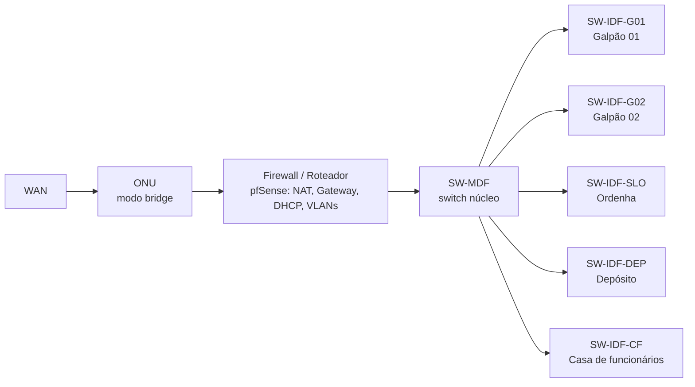

# Projeto de rede para fazenda leiteira

Projeto de rede para fazenda leiteira: cabeamento, VLANs e Wi-Fi. Desenvolvido na disciplina Projeto Integrador: Gestão de Infraestrutura - Unijuí.

> [!WARNING]
> **Aviso sobre as plantas do projeto:** todas as plantas usadas como base deste projeto (planta baixa detalhada, planta simplificada e visão de satélite) foram **geradas com auxílio de inteligência artificial**. Elas têm caráter apenas ilustrativo e acadêmico, podem conter erros e **não garantem exatidão de metragens, escalas, proporções ou dimensões reais**. Essas imprecisões podem ter se refletido nos diagramas e demais materiais produzidos a partir delas.

## Sumário

- [Projeto de rede para fazenda leiteira](#projeto-de-rede-para-fazenda-leiteira)
  - [Sumário](#sumário)
  - [Visão geral](#visão-geral)
  - [Escopo e limitações](#escopo-e-limitações)
  - [Arquitetura](#arquitetura)
  - [VLANs e endereçamento](#vlans-e-endereçamento)
  - [Wi-Fi](#wi-fi)
  - [Validação em laboratório](#validação-em-laboratório)
  - [Orçamento](#orçamento)
  - [Conteúdo do repositório](#conteúdo-do-repositório)
    - [`diagramas/`](#diagramas)
    - [`docs/`](#docs)
    - [`planilhas/`](#planilhas)
    - [`plantas/`](#plantas)
    - [`simulacao/`](#simulacao)
  - [Como abrir os arquivos](#como-abrir-os-arquivos)
  - [Convenções](#convenções)

## Visão geral

A propriedade usada como referência é um **cenário criado pela equipe**: uma fazenda de gado leiteiro em sistema confinado (free-stall).

| Item | Valor |
|---|---|
| Rebanho | Cerca de 300 vacas: 200 em lactação (Galpão 01) e 100 em pré-parto ou transição (Galpão 02) |
| Ordenha | Sala 2x12 com 24 conjuntos, duas vezes ao dia |
| Pessoas na operação | Cerca de 10 |
| Terreno | 160 m x 120 m |
| Edificações | 13 áreas, somando 17.532 m² |
| Rede | 10 APs Wi-Fi, 19 pontos de Ethernet, 5 enlaces de fibra do MDF aos IDFs e 8 VLANs |
| Acesso à internet | Fibra óptica com IP fixo (premissa P7) |

## Escopo e limitações

- A **planta baixa foi gerada com auxílio de inteligência artificial** e pode conter erros. Ela não reflete um projeto real.
- A visita técnica à fazenda real ocorreu em 17/11/2026, só três semanas antes da conclusão. Todo o estudo usa os dados da fazenda de referência.
- O desenho foi validado **apenas em simulação** (Cisco Packet Tracer).
- Os preços são estimativas de referência, sem cotação formal.
- O pfSense em máquina virtual (PIGI-65) e o teste com nmap (PIGI-66) ficaram fora do escopo.
- As premissas estão numeradas de P1 a P7 em `docs/PIGI-26-27-95-99 - Perfil Propriedade e Premissas.docx`.

## Arquitetura



- O **MDF** fica na área administrativa. Cada **IDF** atende uma edificação.
- Os troncos levam as VLANs 10, 20, 30, 40, 50, 60 e 99, com a VLAN 999 como nativa.
- Os diagramas completos estão em `diagramas/`.

## VLANs e endereçamento

| VLAN | Nome | Uso | Rede |
|---|---|---|---|
| 10 | Administrativo | Escritório, gestão e impressoras | 10.73.10.0/24 |
| 20 | Produção | Computadores e equipamentos da ordenha | 10.73.20.0/24 |
| 30 | CFTV | Câmeras IP (CFTV) | 10.73.30.0/24 |
| 40 | Visitantes | Celulares e notebooks de visitantes, só internet | 10.73.40.0/24 |
| 50 | Telemetria | Sensores e dispositivos IoT | 10.73.50.0/24 |
| 60 | Servidores | NVR, armazenamento e serviços internos | 10.73.60.0/24 |
| 99 | Gerência | Switches, APs e firewall, só equipe técnica | 10.73.99.0/24 |
| 999 | Nativa nula | Sem dispositivos e sem DHCP | n/a |

- O gateway de cada rede é o `.1`, e o domínio interno é `fazenda.lan`.
- As faixas de DHCP, as reservas por MAC e a convenção de nomes estão em `planilhas/PIGI-102-109-125-137 - Plano Endereçamento IP-DHCP-WiFi.xlsx`.
- A matriz de comunicação entre as VLANs (21 pares) e as justificativas estão em `planilhas/PIGI-101-103-105-106 - Plano de VLANs e Permissões.xlsx`.

## Wi-Fi

São 3 SSIDs:

| SSID | VLAN | APs |
|---|---|---|
| Fazenda-Admin | 10 | AP-ADM-01, AP-REF-01, AP-CF-01 |
| Fazenda-Producao | 20 | Galpões, ordenha e depósito |
| Fazenda-Visitantes | 40 | Todos os 10 APs, com isolamento entre clientes |

O plano de canais e potência de cada AP e a cobertura estimada estão na planilha de endereçamento e em `diagramas/PIGI-87 - Diagrama Cobertura Wifi.png`.

## Validação em laboratório

O laboratório rodou no Packet Tracer em duas etapas: `simulacao/PIGI-63 - Simulacao 01 VLANs e DHCP.pkt` (testes L1 a L4: VLANs, troncos, roteamento inter-VLAN e DHCP) e `simulacao/PIGI-64 - Simulacao 02 ACLs e Alcance.pkt` (teste L5, com as regras de firewall aplicadas como ACLs no FW-01). Em 10/11/2026, os **34 testes** da matriz de alcance deram o resultado previsto: 21 pares de VLAN, 10 de sentido contrário e 3 extras.

| Teste | Resultado |
|---|---|
| L1 VLANs e portas de acesso | Conforme |
| L2 Troncos 802.1Q com nativa 999 | Conforme |
| L3 Roteamento entre VLANs | Conforme |
| L4 DHCP | Conforme |
| L5 Matriz de alcance | 34 de 34 conforme |
| L6 pfSense em VM (PIGI-65) | Não executado |
| L7 nmap (PIGI-66) | Não executado |

O Packet Tracer não gera SSH, SMB, Modbus, RTSP, MQTT nem SNMP. Essas regras estão nas ACLs, mas não foram exercitadas. As evidências estão nos prints de `simulacao/PIGI-63 - Prints/` (L1 a L4) e `simulacao/PIGI-64 - Prints/` (L5), e consolidadas em `docs/PIGI-69 - Evidencias e Correcoes.docx`.

## Orçamento

A lista de materiais (`planilhas/PIGI-60 - Materiais e Orçamento.xlsx`) tem **total estimado de R$ 47.624,36**, incluindo 12% de margem de contingência e instalação. Os preços são à vista, coletados entre setembro e outubro de 2026 nas lojas indicadas na própria planilha. Câmeras, NVR, servidor e sensores ainda não entram.

## Conteúdo do repositório

```text
.
├── README.md
├── diagramas/
├── docs/
├── planilhas/
├── plantas/
└── simulacao/
    ├── PIGI-63 - Prints/
    └── PIGI-64 - Prints/
```

### `diagramas/`

| Arquivo | Tarefa | Conteúdo |
|---|---|---|
| `PIGI-63 - Diagrama Topologia Simulacao 01.png` | PIGI-63 | Topologia do laboratório no Packet Tracer |
| `PIGI-87 - Diagrama Cobertura Wifi.png` | PIGI-87 | Cobertura Wi-Fi |
| `PIGI-100 - Diagrama Topologia Lógica Rede` (`.drawio` e `.drawio.png`) | PIGI-100 | Topologia lógica da rede |
| `PIGI-112 - Diagrama Planta Infraestrutura Física Rede` (`.drawio` e `.drawio.png`) | PIGI-112 | Infraestrutura física sobre a planta |

### `docs/`

| Arquivo | Tarefas | Conteúdo |
|---|---|---|
| `PIGI-26-27-95-99 - Perfil Propriedade e Premissas.docx` | PIGI-26, 27, 95, 99 | Perfil da propriedade, áreas, premissas P1 a P7 e limitações |
| `PIGI-63 - Equipamentos e Ligacoes.docx` | PIGI-63 | Equipamentos, cabos e ligações do laboratório |
| `PIGI-64 - Matriz de Alcance VLANs.docx` | PIGI-64 | Teste de alcance entre as VLANs e ACLs aplicadas |
| `PIGI-69 - Evidencias e Correcoes.docx` | PIGI-69 | Evidências do laboratório e correções para o relatório final |

### `planilhas/`

| Arquivo | Tarefas | Conteúdo |
|---|---|---|
| `PIGI 122 - Pontos de Rede.xlsx` | PIGI-122 | Pontos de rede, infraestrutura e ocupação dos switches |
| `PIGI-101-103-105-106 - Plano de VLANs e Permissões.xlsx` | PIGI-101, 103, 105, 106 | VLANs, pares, permissões por porta e justificativas |
| `PIGI-102-109-125-137 - Plano Endereçamento IP-DHCP-WiFi.xlsx` | PIGI-102, 109, 125, 137 | Endereçamento, DHCP, SSIDs, canais e potência, reservas e nomes |
| `PIGI-12-15-130-136 - Regras Firewall.xlsx` | PIGI-12, 15, 130, 136 | Matriz de regras de firewall |
| `PIGI-60 - Materiais e Orçamento.xlsx` | PIGI-60 | Lista de materiais e orçamento estimado |

### `plantas/`

| Arquivo | Tarefa | Conteúdo |
|---|---|---|
| `PIGI-32 - Planta Baixa Detalhada.png` | PIGI-32 | Planta baixa detalhada |
| `PIGI-32 - Planta Baixa Simplificada.png` | PIGI-32 | Planta baixa simplificada |
| `PIGI-32 - Visao Satelite Planta Baixa.png` | PIGI-32 | Visão de satélite com a planta |

### `simulacao/`

| Arquivo | Tarefa | Conteúdo |
|---|---|---|
| `PIGI-63 - Simulacao 01 VLANs e DHCP.pkt` | PIGI-63 | Laboratório do Packet Tracer — configuração base (L1 a L4) |
| `PIGI-63 - Prints/` (`Print 01` a `Print 06`) | PIGI-63 | Evidências L1–L4: VLANs no MDF e IDF-G01, troncos, rotas no FW-01, ping e DHCP |
| `PIGI-64 - Simulacao 02 ACLs e Alcance.pkt` | PIGI-64 | Laboratório do Packet Tracer — matriz de alcance com ACLs (L5) |
| `PIGI-64 - Prints/` (`Print 01` a `Print 06`) | PIGI-64 | Evidências L5: ACLs, ping bloqueado, HTTPS liberado e bloqueado, ping da gerência e servidor bloqueado |

## Como abrir os arquivos

| Extensão | Programa |
|---|---|
| `.drawio` | diagrams.net (draw.io) |
| `.pkt` | Cisco Packet Tracer |
| `.xlsx` | Excel, LibreOffice ou Google Planilhas |
| `.docx` | Word, LibreOffice ou Google Docs |

## Convenções

- Todo arquivo começa com o código da tarefa: `PIGI-<número> - descrição`. Documentos que cobrem várias tarefas listam todos os números.
- Cada arquivo fica na pasta do seu tipo: diagramas em `diagramas/`, textos em `docs/`, tabelas em `planilhas/`, plantas em `plantas/` e arquivos da simulação em `simulacao/`.
